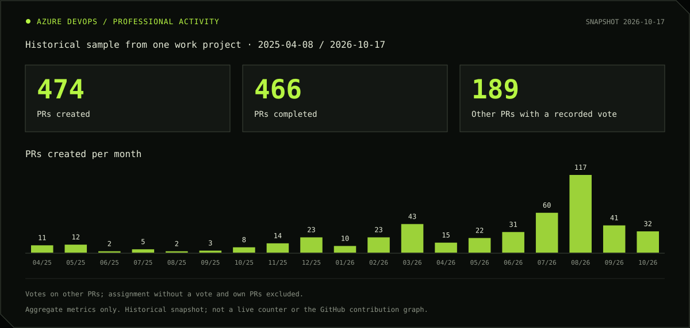
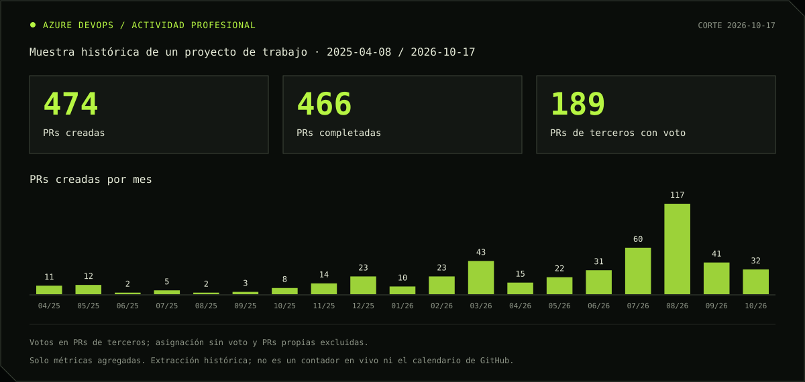

  <a href="https://www.bernidev.cl"><strong>Portfolio / CV ↗</strong></a>
  &nbsp; · &nbsp;
  <a href="https://www.linkedin.com/in/bernardo-carvajal-rivera/">LinkedIn ↗</a>
  &nbsp; · &nbsp;
  <a href="#en-español">En español ↓</a>

I build fintech products where mistakes are expensive: clear architecture, traceable flows, and delivery that reaches production.

**Product Tech Lead at Voultech**, with senior full-stack ownership across UI, APIs, data, releases and operations. My background in Organizational Psychology helps me connect business needs, technical decisions and the people delivering the product.

### 01 / Product & engineering

| Focus | Work |
| :--- | :--- |
| **Advisor Portal** | A digital workspace for financial advisors: architecture, product delivery and QA/production releases. |
| **Financial operations** | APV contributions and withdrawals, queued order processing and auditable operational workflows. |
| **Engineering standards** | Angular architecture, Atomic Design, reusable components and code review. |

### 02 / Stack

**Frontend** &nbsp; Angular · TypeScript · RxJS  
**Backend & data** &nbsp; C# / .NET · REST APIs · SQL Server  
**Cloud & operations** &nbsp; Azure Functions · Service Bus · Azure DevOps · Redis · Docker

Explore the experience and case studies at **[www.bernidev.cl](https://www.bernidev.cl)**.

### 03 / Professional activity

My day-to-day professional repositories live in **Azure DevOps**, so that work is absent from GitHub’s native contribution graph. This panel makes a historical sample visible through aggregate metrics.

**Snapshot: October 17, 2026 · Coverage: April 8, 2025 – October 17, 2026 · One work project.**

- Created PRs have verified authorship and are counted once. Of 474 created PRs, 466 were completed, 7 abandoned and 1 active at extraction time.
- Review participation counts **189 PRs by other authors with a recorded vote**. Assignment without a vote and my own PRs are excluded; this is not a count of approvals or review comments.
- The chart groups PR creation by month in Santiago time; October 2026 is partial. It does not measure commits, working hours or productivity.
- Only dates and aggregate counts are published. No work source code, repository names, PR titles, people, internal links or credentials are included in the panel.

This is a **historical single-project snapshot**, not a live feed or my full professional activity. It does not add contributions to GitHub’s native calendar.

[View the panel and methodology on Bernidev ↗](https://www.bernidev.cl/actividad) · [Aggregate data](./assets/activity/azure-devops-activity.json)

---

### En español

<strong>Producto fintech, desarrollo y liderazgo técnico</strong>

Construyo producto fintech donde el costo del error es alto: arquitectura clara, flujos trazables y delivery que llega a producción.

Soy **Product Tech Lead en Voultech**, con responsabilidad full-stack senior sobre UI, APIs, datos, releases y operación. Mi formación en Psicología Organizacional me permite traducir entre negocio y tecnología y acompañar a los equipos en la entrega.

- **Portal Asesores:** puesto de trabajo digital para el canal asesor; arquitectura, delivery y releases QA/producción.
- **Operaciones financieras:** aportes y retiros APV, procesamiento de órdenes con colas y flujos auditables.
- **Estándares de ingeniería:** arquitectura Angular, Atomic Design, componentes reutilizables y revisión de código.

La experiencia y los casos de trabajo están en **[www.bernidev.cl](https://www.bernidev.cl)**.

#### Actividad profesional en Azure DevOps

Mis repositorios de trabajo están en **Azure DevOps**; esa actividad no aparece en el calendario nativo de GitHub. Este panel muestra una parte de mi trabajo mediante métricas agregadas.

**Corte: 17 de octubre de 2026 · Cobertura: 8 de abril de 2025 – 17 de octubre de 2026 · Un proyecto de trabajo.**

Las PRs creadas tienen autoría verificada y se cuentan una sola vez: 466 completadas, 7 descartadas y 1 activa. Las 189 PRs de terceros tienen un voto registrado; se excluyen la asignación sin voto y las PRs propias. No equivale a 189 aprobaciones ni a 189 comentarios.

La serie mensual agrupa creación de PRs en horario de Santiago; el último mes es parcial. Es una muestra histórica, no un contador en vivo ni toda mi actividad profesional. Solo se publican fechas y conteos, sin código ni datos privados del trabajo. Estas cifras no se incorporan al calendario de GitHub ni miden horas o productividad.

[Panel y metodología en Bernidev ↗](https://www.bernidev.cl/actividad)

Santiago, Chile · Español / English

