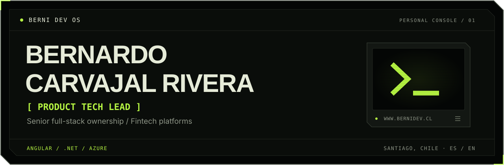

  <a href="https://www.bernidev.cl"><strong>Portfolio / CV ↗</strong></a>
  &nbsp; · &nbsp;
  <a href="https://www.linkedin.com/in/bernardo-carvajal-rivera/">LinkedIn ↗</a>
  &nbsp; · &nbsp;
  <a href="#en-español">En español ↓</a>

I build fintech products where mistakes are expensive: clear architecture, traceable flows, and delivery that reaches production.

**Product Tech Lead at Voultech**, with senior full-stack ownership across UI, APIs, data, releases and operations. My background in Organizational Psychology helps me connect business needs, technical decisions and the people delivering the product.

### 01 / Product & engineering

| Focus | Work |
| :--- | :--- |
| **Advisor Portal** | A digital workspace for financial advisors: architecture, product delivery and QA/production releases. |
| **Financial operations** | APV contributions and withdrawals, queued order processing and auditable operational workflows. |
| **Engineering standards** | Angular architecture, Atomic Design, reusable components and code review. |

### 02 / Stack

**Frontend** &nbsp; Angular · TypeScript · RxJS  
**Backend & data** &nbsp; C# / .NET · REST APIs · SQL Server  
**Cloud & operations** &nbsp; Azure Functions · Service Bus · Azure DevOps · Redis · Docker

Explore the experience and case studies at **[www.bernidev.cl](https://www.bernidev.cl)**.

---

### En español

<strong>Producto fintech, desarrollo y liderazgo técnico</strong>

Construyo producto fintech donde el costo del error es alto: arquitectura clara, flujos trazables y delivery que llega a producción.

Soy **Product Tech Lead en Voultech**, con responsabilidad full-stack senior sobre UI, APIs, datos, releases y operación. Mi formación en Psicología Organizacional me permite traducir entre negocio y tecnología y acompañar a los equipos en la entrega.

- **Portal Asesores:** puesto de trabajo digital para el canal asesor; arquitectura, delivery y releases QA/producción.
- **Operaciones financieras:** aportes y retiros APV, procesamiento de órdenes con colas y flujos auditables.
- **Estándares de ingeniería:** arquitectura Angular, Atomic Design, componentes reutilizables y revisión de código.

La experiencia y los casos de trabajo están en **[www.bernidev.cl](https://www.bernidev.cl)**.

Santiago, Chile · Español / English

